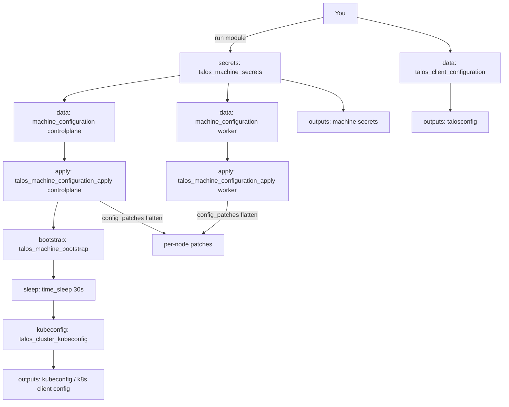

# AGENTS.md

# Project Overview

This repository is a Terraform / OpenTofu module that provisions a Kubernetes
cluster on bare-metal servers running [Talos Linux](https://www.talos.dev/).
Given a map of control-plane and worker node data (IPs, install disks, per-node
patches), it generates machine secrets, applies control-plane and worker machine
configurations, bootstraps the cluster, and emits a `talosconfig` and `kubeconfig`.
It is consumed as a Terraform module (see README's `module "talos"` block), not
deployed in place. Node servers must already be booted into Talos maintenance mode.

# Repository Structure

- `main.tf` — Core module logic: machine secrets, machine configuration data
  sources, config application per node, bootstrap, and kubeconfig retrieval.
- `variables.tf` — Input variables: cluster metadata, version pins, node_data
  maps, and patch-list inputs.
- `outputs.tf` — Sensitive outputs: `talosconfig`, machine secrets, `kubeconfig`,
  and the Kubernetes client configuration.
- `version.tf` — Provider requirements (`siderolabs/talos >= 0.10.1`,
  `alxrem/jsonnet >= 2.2.0`).
- `flake.nix` / `flake.lock` — Nix flake providing a dev shell with `opentofu`.
- `.envrc` — Registers the flake dev shell with direnv (`use flake`).
- `.gitlab-ci.yml` — GitLab CI: OpenTofu `fmt`/`validate` jobs via a remote job
  template component, plus a release pipeline.
- `GitVersion.yml` — GitVersion config (Mainline mode) used by the release job.
- `README.md` — Module usage and requirements example.
- `.gitignore` — Ignores local state, `.terraform/`, and all `*.tfvars`.
- Local-only (ignored, not committed): `terraform.tfvars`, `terraform.tfstate`,
  `terraform.tfstate.backup`, `.terraform/`, `.direnv/`.

# Build & Development Commands

The module is defined in OpenTofu. Use the flake dev shell (entered
automatically via direnv, or manually via `nix develop`). `terraform` is
typically not installed; use the `tofu` (`opentofu`) binaries.

Enter the dev shell:

```bash
# If direnv is loaded (enters automatically)
direnv allow
# Manual
nix develop
```

Initialize, plan, apply (local test state):

```bash
opentofu init
opentofu plan      # no -out needed for ad-hoc checks
opentofu apply
```

Format and validate (mirrors CI jobs):

```bash
opentofu fmt -check -recursive
opentofu validate
```

Destroy nodes when decommissioning (also triggers cluster reset/reboot on
destroy by design):

```bash
opentofu destroy
```

> TODO: no explicit `lint`, `test`, or `debug` commands exist beyond `fmt` and
> `validate`. No Terraform cloud backend is configured; state lives locally.

# Code Style & Conventions

- HCL 1.x; format with `opentofu fmt` (enforced in CI).
- Module inputs are typed and described; optional fields use `optional(...)`
  (see `variables.tf`).
- Version constraints use `>=` in `version.tf`; downstream consumers pin.
- Per-node overrides (install disk/image/selector, patches) are merged into
  machine config as `yamlencode` patches composed with global patch lists.
- Node data map keys are node names; nodes carry `ip_address` plus optional
  `install_disk`, `install_disk_selector`, `install_image`, `talos_patches`.
- Sensitive values are exposed only through `sensitive = true` outputs.
- Commit messages follow Conventional Commits with scope of the affected area,
  e.g. `feat(talos): ...`, `chore(talos): bump talos provider`, `fix(*): ...`.
- No comments in code unless they clarify a non-obvious default or migration.

# Architecture Notes



Flow: `talos_machine_secrets` generates cluster-sensitive material once.
Machine configuration for controlplane and worker types is templated from
cluster/version inputs, then per node combined with cert SANs, install
settings, and the `config_patches_*` lists (`yamlencode` merged via
`concat`). Each node gets its config applied via
`talos_machine_configuration_apply`. The first controlplane address (or a
load-balanced VIP in `controlplane_address` / `cluster_endpoint`) becomes the
cluster endpoint; after apply the cluster is bootstrapped, a 30s settle
`time_sleep` waits for the control plane, and `talos_cluster_kubeconfig`
captures cluster access. Destroy resets and reboots nodes (graceful off).

Cluster endpoint derivation: `cluster_endpoint` var, else
`https://<controlplane_address>:6443`, else IP of first controlplane node.

# Testing Strategy

- No unit/integration/e2e tests exist in the repo.
- CI validates the module statically via the OpenTofu job template component
  (`.gitlab-ci.yml`):
  - `fmt` job runs `opentofu fmt`.
  - `validate` job runs `opentofu validate`.
- Run the same checks locally:

```bash
opentofu fmt -check -recursive && opentofu validate
```

> TODO: no real-cluster smoke test is defined. To validate against live nodes,
> provision nodes in maintenance mode and `opentofu apply` a test config.

# Security & Compliance

- State files and all `.tfvars` are gitignored; treat them as confidential
  (`terraform.tfstate` holds machine secrets in plaintext).
- Machine secrets, `talosconfig`, and `kubeconfig` are emitted only via
  `sensitive` outputs to avoid plan/console exposure.
- Cluster data flows are intended to run over TLS: the endpoint defaults to
  `https://...:6443`.

> TODO: no dependency scanning (e.g. trivy, osv-scanner) or provider
> signature/checksum policy is configured. No license file is present.
> `terraform.tfvars` in the working tree currently contains values
> (`192.168.13.x`) that look like a leftover test environment — do not commit.

# Agent Guardrails

- Do not commit `terraform.tfvars`, `*.tfstate`, or `.terraform/` content —
  they are intentionally gitignored.
- Do not modify or commit local `terraform.tfstate` / `terraform.tfstate.backup`;
  they are machine-local artifacts.
- Never run `tofu apply` / `tofu destroy` against real nodes without explicit
  user instruction; apply/destroy mutates live bare-metal infrastructure.
- Do not pin/unpin provider versions without updating them coherently — version
  bumps are conventionally separate `chore(talos): ...` commits.
- Keep generated/closed-source GitLab CI component inputs unmodified unless the
  referenced template itself is being upgraded.
- Preserve the `--check`/`-check` flag on `fmt` in CI; do not auto-rewrite HCL
  formatting silently.

# Extensibility Hooks

- `var.config_patches_all` — YAML patches applied to every node.
- `var.config_patches_controlplane` / `var.config_patches_worker` — role-specific
  YAML patches.
- Per-node `talos_patches` in `var.node_data` — patches scoped to a single node.
- `install_image` / `install_disk_selector` per node — override Talos install
  artifact and disk selection.
- `kubernetes_version`, `talos_version` — version pins threaded into machine
  configuration.
- `cluster_endpoint` / `controlplane_address` — decouple cluster endpoint from
  first node IP (e.g. for a load balancer/VIP).

> TODO: no feature flags or environment-variable based configuration exist; all
> knobs are Terraform variables above.

# Further Reading

- [README.md](README.md) — module usage example and requirements.
- [.gitlab-ci.yml](.gitlab-ci.yml) — CI pipeline definition (OpenTofu jobs +
  release workflow).
- [main.tf](main.tf), [variables.tf](variables.tf), [outputs.tf](outputs.tf) —
  the complete module source.