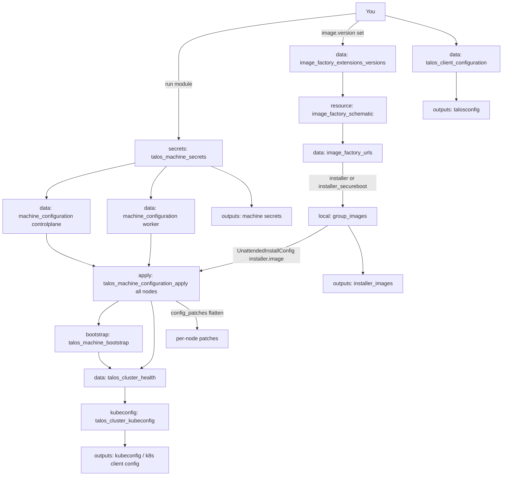

# AGENTS.md

# Project Overview

This repository is a Terraform / OpenTofu module that provisions a Kubernetes
cluster on bare-metal servers running [Talos Linux](https://www.talos.dev/).
Given node groups (a role, an image spec, shared settings) with per-node IPs and
overrides, it resolves Talos installer images (via Image Factory or a raw
installer ref), generates machine secrets, applies controlplane and worker
machine configurations, bootstraps the cluster, and emits a `talosconfig` and
`kubeconfig`. It is consumed as a Terraform module (see README's `module "talos"`
block), not deployed in place. Node servers must already be booted into Talos
maintenance mode.

# Repository Structure

- `main.tf` — Core module logic: Image Factory extensions, schematic and URL
  resolution, machine secrets, machine configuration data sources, per-node
  config application (certSANs, `UnattendedInstallConfig`, `KubeNodeConfig`,
  `KubeletConfig` patches), bootstrap, and kubeconfig retrieval.
- `variables.tf` — Input variables: cluster metadata, version pins, `node_groups`
  (roles, image specs, shared and per-node settings), `config_patches`,
  `allow_scheduling_on_controlplanes`, `kubelet_server_tls_bootstrap`,
  `apply_mode`, and input validations.
- `outputs.tf` — Sensitive outputs: `talosconfig`, machine secrets, `kubeconfig`,
  and the Kubernetes client configuration; plus the non-sensitive
  `installer_images` per node group and `manifests_sync_command`.
- `addons.tf` — `addons` input and the addon patches: inline manifests for
  kubelet-serving-cert-approver, metrics-server and local-path-provisioner
  (adapted for Talos), plus the local-path `UserVolumeConfig`.
- `cilium.tf` — `cni` input; renders the vendored Cilium chart with
  `helm_template` and builds the control-plane CNI patches.
- `deps/` — `vendir.yml` / `vendir.lock.yml` and the vendored upstream content
  in `deps/vendor/` (Cilium chart, addon manifests), committed.
- `version.tf` — Provider requirements (`siderolabs/talos >= 0.12.0`,
  `hashicorp/helm >= 3.0`).
- `tests/main.tftest.hcl` — `tofu test` suite using `mock_provider "talos"` and
  `mock_provider "helm"` (runs offline): apply runs for config generation,
  overrides, addons and Cilium; plan runs for validation rules.
- `docs/` — User documentation: `node-groups.md`, `images.md`,
  `disk-selection.md`, `config-patches.md`, `kubernetes-nodes.md`, `cilium.md`,
  `addons.md`, `upgrading-to-v1.md`, `talosconfig-renewal.md`.
- `.terraform-docs.yml` — terraform-docs settings; injects the generated inputs
  and outputs tables into the `BEGIN_TF_DOCS` block of `README.md`.
- `flake.nix` / `flake.lock` — Nix flake providing a dev shell with `opentofu`,
  `terraform-docs`, `vendir` and `helm`.
- `.envrc` — Registers the flake dev shell with direnv (`use flake`).
- `.github/workflows/ci.yml` — GitHub Actions CI: OpenTofu `fmt`, `validate`,
  `test`, and `vendir` (vendored deps match the lock file) jobs via reusable
  actions from `RocketPadPlatforms/github-actions`.
- `.github/workflows/release-please.yml` — Tagged releases via release-please,
  driven by Conventional Commits.
- `renovate.json` — Mend-hosted Renovate config (dependency/version updates).
- `README.md` — Module usage, generated docs, security notes, and docs index.
- `.gitignore` — Ignores local state, `.terraform/`, and all `*.tfvars`.
- Local-only (ignored, not committed): `terraform.tfvars`, `terraform.tfstate`,
  `terraform.tfstate.backup`, `.terraform/`, `.direnv/`.

# Build & Development Commands

The module is defined in OpenTofu. Use the flake dev shell (entered
automatically via direnv, or manually via `nix develop`). `terraform` is
typically not installed; use the `tofu` (`opentofu`) binaries.

Enter the dev shell:

```bash
# If direnv is loaded (enters automatically)
direnv allow
# Manual
nix develop
```

Initialize, plan, apply (local test state):

```bash
opentofu init
opentofu plan      # no -out needed for ad-hoc checks
opentofu apply
```

Format, validate, and test (mirrors CI jobs):

```bash
opentofu fmt -check -recursive
opentofu validate
opentofu test
```

Regenerate the README docs block (after changing variables or outputs):

```bash
terraform-docs .
```

Update vendored upstream content (after changing a version in `deps/vendir.yml`)
and check it matches the lock file (as CI does):

```bash
cd deps
vendir sync
vendir sync -l && git diff --exit-code -- vendor vendir.lock.yml
```

Destroy nodes when decommissioning (also triggers cluster reset/reboot on
destroy by design):

```bash
opentofu destroy
```

> TODO: no explicit `lint` or `debug` commands exist beyond `fmt`, `validate`,
> and `test`. No Terraform cloud backend is configured; state lives locally —
> consumers should use an encrypted backend (see [README.md](README.md)).

# Code Style & Conventions

- HCL 1.x; format with `opentofu fmt` (enforced in CI).
- Module inputs are typed and described; optional fields use `optional(...)`
  (see `variables.tf`).
- Version constraints use `>=` in `version.tf`; downstream consumers pin.
- `node_groups` keys are group names. Each group sets `role` (`controlplane` or
  `worker`), `image` (either `version` for Image Factory or `installer` as a raw
  ref, never both), `nodes`, and optional `install_disk_match`, `labels`,
  `annotations`, `taints`, `config_patches`.
- `nodes` keys are node names, unique across all groups. Each node carries
  `ip_address` plus optional `install_disk_match`, `labels`, `annotations`,
  `taints`, `config_patches`.
- Node settings inherit from their group. `install_disk_match` is replaced by the
  node value; `labels`, `annotations`, and `taints` are merged with node keys
  winning.
- Patch order per node: generated patches (certSANs, `UnattendedInstallConfig`,
  control-plane taint removal, `KubeNodeConfig`, `KubeletConfig`, addon
  `UserVolumeConfig`, then on control planes the Cilium and addon documents),
  then `config_patches`, then group `config_patches`, then node
  `config_patches`. New generated patches go after the existing ones so tests'
  patch indexes stay stable. All
  patches are YAML strings, typically built with `yamlencode`.
- Sensitive values are exposed only through `sensitive = true` outputs.
- Commit messages follow Conventional Commits with scope of the affected area,
  e.g. `feat(talos): ...`, `chore(talos): bump talos provider`, `fix(*): ...`.
- No comments in code unless they clarify a non-obvious default or migration.

# Architecture Notes



Flow: for each group with `image.version`, the extensions are looked up, a
schematic is created, and installer URLs are resolved (`installer_secureboot`
when `secureboot` is set); groups with `image.installer` use that ref as-is.
`talos_machine_secrets` generates cluster-sensitive material once. Machine
configuration for controlplane and worker types is templated from cluster and
version inputs. A single `talos_machine_configuration_apply` resource keyed over
all nodes (`local.all_nodes`) applies each node's config, selecting the
role-specific config source, the group's installer image, and the merged patch
list. The first controlplane node (sorted by name) is the default cluster
endpoint; bootstrap and kubeconfig always target it, never a VIP. After apply the
cluster is bootstrapped, then `talos_cluster_health` polls until the control
plane and Kubernetes are healthy (unless `enable_cluster_health_check` is false),
and `talos_cluster_kubeconfig` captures cluster access. Destroy resets and
reboots nodes (graceful off).

Cluster endpoint derivation: `cluster_endpoint` var, else
`https://<controlplane_address>:6443`, else IP of first controlplane node.

# Testing Strategy

- `tests/main.tftest.hcl` covers the module offline with `mock_provider "talos"`
  and `mock_provider "helm"` (the Cilium manifest is mocked; vendored addon
  files are read for real):
  - `apply` runs check generated config for a basic controlplane and worker
    setup, per-node overrides, scheduling and TLS settings, each addon, Cilium,
    and the `manifests_sync_command` output.
  - `plan` runs check that invalid inputs are rejected (role, unique node
    names, image installer vs. version, talos_version floor, taint effect,
    `cni` name/configuration, Cilium without `kubernetes_version`).
- CI validates the module via GitHub Actions (`.github/workflows/ci.yml`):
  - `fmt` job runs `opentofu fmt -check -recursive`.
  - `validate` job runs `opentofu init -backend=false` + `opentofu validate`.
  - `test` job runs `opentofu init -backend=false -input=false` + `opentofu test`.
  - `vendir` job runs `vendir sync -l` in `deps/` and fails on any diff.
- Run the same checks locally:

```bash
opentofu fmt -check -recursive && opentofu validate && opentofu test
```

> TODO: no real-cluster smoke test is defined. To validate against live nodes,
> provision nodes in maintenance mode and `opentofu apply` a test config.

# Security & Compliance

- State files and all `.tfvars` are gitignored; treat them as confidential
  (`terraform.tfstate` holds machine secrets in plaintext).
- Machine secrets, `talosconfig`, and `kubeconfig` are emitted only via
  `sensitive` outputs to avoid plan/console exposure. `installer_images` is not
  sensitive and contains only image references.
- Cluster data flows are intended to run over TLS: the endpoint defaults to
  `https://...:6443`.
- Consumers should use an encrypted remote backend and restrict state access;
  see the Secure your state section in [README.md](README.md). This module
  itself does not configure a backend (state lives with the consumer).

> TODO: no dependency scanning (e.g. trivy, osv-scanner) or provider
> signature/checksum policy is configured.
> `terraform.tfvars` in the working tree currently contains values
> (`192.168.13.x`) that look like a leftover test environment — do not commit.

# Agent Guardrails

- Do not commit `terraform.tfvars`, `*.tfstate`, or `.terraform/` content —
  they are intentionally gitignored.
- Do not modify or commit local `terraform.tfstate` / `terraform.tfstate.backup`;
  they are machine-local artifacts.
- Never run `tofu apply` / `tofu destroy` against real nodes without explicit
  user instruction; apply/destroy mutates live bare-metal infrastructure.
- Do not pin/unpin provider versions without updating them coherently — version
  bumps are conventionally separate `chore(talos): ...` commits.
- Preserve the `--check`/`-check` flag on `fmt` in CI; do not auto-rewrite HCL
  formatting silently.
- Keep the README `BEGIN_TF_DOCS` block generated with `terraform-docs .`; do not
  hand-edit it.
- Never hand-edit `deps/vendor/`; change `deps/vendir.yml` and run `vendir sync`.
- Cilium and the addons are owned by Talos (`talosctl upgrade-k8s`) after
  bootstrap; GitOps must not manage them.
- Rendered manifests must be reproducible: never enable chart options that
  generate random content at render time (e.g. Cilium `tls.auto.method: helm`),
  or every plan re-applies node configuration.

# Extensibility Hooks

- `var.config_patches` — YAML patches applied to every node.
- `node_groups.*.config_patches` — YAML patches applied to every node in a group.
- `node_groups.*.nodes.*.config_patches` — YAML patches scoped to a single node.
- `node_groups.*.image` — `version` with `extensions`, `extra_kernel_args`,
  `architecture`, `platform`, `secureboot` (Image Factory), or `installer` (raw
  installer ref).
- `node_groups.*.install_disk_match` / node-level override — CEL disk selector
  for the install disk.
- `node_groups.*.labels`, `annotations`, `taints` (and per-node overrides) —
  Kubernetes node metadata applied via `KubeNodeConfig`.
- `allow_scheduling_on_controlplanes` — removes the default control-plane
  NoSchedule taint.
- `kubelet_server_tls_bootstrap` — enables kubelet serving certificate
  bootstrapping on all nodes (requires a CSR approver).
- `addons` — `kubelet_cert_approver`, `metrics_server`,
  `local_path_provisioner` (`enabled` plus per-addon settings). New addons add
  a field, a `deps/vendir.yml` entry, and an inline manifest entry.
- `cni` — `name` (`flannel` or `cilium`) and `configuration` (Cilium Helm
  values over the module's base values).
- `manifests_sync_command` output — `talosctl upgrade-k8s` at the current
  Kubernetes version to upgrade, remove, or re-sync Cilium and addons.
- `apply_mode` — `talos_machine_configuration_apply` mode (e.g.
  `staged_if_needing_reboot` for safe migrations).
- `kubernetes_version`, `talos_version` — version pins threaded into machine
  configuration. `talos_version` is the config contract (v1.14+), not the
  installed version; set installed versions via `node_groups.*.image`.
- `cluster_endpoint` / `controlplane_address` — decouple cluster endpoint from
  first node IP (e.g. for a load balancer/VIP).
- `enable_cluster_health_check` — skip the cluster health wait when the node
  address topology does not match `ip_address`.

> TODO: no feature flags or environment-variable based configuration exist; all
> knobs are Terraform variables above.

# Further Reading

- [README.md](README.md) — module usage example, generated inputs and outputs,
  security guidance, and talosconfig renewal/recovery guidance.
- [docs/](docs/) — node groups, images, disk selection, config patches,
  Kubernetes nodes, upgrading to v1, and talosconfig renewal.
- [.github/workflows/ci.yml](.github/workflows/ci.yml) — CI pipeline
  definition (OpenTofu `fmt`/`validate`/`test` jobs).
- [main.tf](main.tf), [variables.tf](variables.tf), [outputs.tf](outputs.tf),
  [tests/main.tftest.hcl](tests/main.tftest.hcl) — the complete module source
  and its tests.
